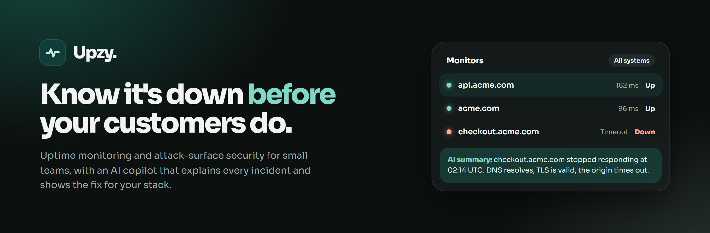

<p align="center">
  
</p>

<p align="center">
  <b>Uptime monitoring and external attack-surface security for small teams.</b><br />
  One tool that tells you when you're down, what you're exposing, and exactly how to fix it.
</p>

---

## Why Upzy

Small teams usually run two tools: a cheap uptime pinger, and (if they can afford it) a security scanner written for security teams. The first knows nothing about your exposure. The second reports problems in jargon and never tells you whether the site is even up.

Upzy puts both in one place and keeps the output readable:

- **Know first.** Checks run every minute. An outage opens one incident after repeated failures (so a blip doesn't page you), alerts you where you already work, and closes itself when the site recovers.
- **See what you expose.** Passive scans of your domains: certificates, security headers, email authentication, dangling DNS, forgotten subdomains and known CVEs for the software you run, ranked by real-world risk.
- **Get the fix, not a report.** Every finding comes with the change to make for _your_ stack (nginx, Apache, Caddy, Cloudflare, Vercel and more), and a **Verify fix** button re-checks it right away.
- **Stay in control.** AI is opt-in, runs on _your_ provider key, and only ever drafts or explains. Nothing changes without a person confirming it.

## What you get

<table>
  <tr>
    <td width="50%" valign="top">
      <h3>Uptime monitoring</h3>
      HTTP, TCP, DNS and SSL checks, keyword and JSON assertions, multi-step API flows with values passed between steps, encrypted secrets, heartbeat monitors for cron jobs and workers, and a degraded state that flags slow-but-up services without raising an incident.
    </td>
    <td width="50%" valign="top">
      <h3>Attack-surface scanning</h3>
      TLS, headers and cookies, SPF/DMARC/CAA, subdomain takeover, and CVEs enriched with CISA KEV and EPSS. Subdomains found in certificate-transparency logs are offered as suggestions you accept or dismiss.
    </td>
  </tr>
  <tr>
    <td valign="top">
      <h3>A grade for every site</h3>
      An A to F health score per domain, with a category breakdown and a 90-day trend, so "are we OK?" has a one-letter answer.
    </td>
    <td valign="top">
      <h3>Alerts that behave</h3>
      Email, Slack, Discord and HMAC-signed webhooks. One outage is one incident: a message when it opens and another when it recovers. Related incidents on the same site or address are grouped, and every alert still reaches you. Scheduled maintenance windows keep planned downtime from paging anyone.
    </td>
  </tr>
  <tr>
    <td valign="top">
      <h3>Public status pages</h3>
      Per-service status (including degraded and under maintenance, with upcoming windows announced), 90 days of uptime, incident updates, double opt-in email subscribers, custom domains with automatic HTTPS, and an optional security-grade badge. Only the names you choose are shown.
    </td>
    <td valign="top">
      <h3>AI that explains</h3>
      Plain-English impact and fixes for findings, a likely cause when a monitor goes down, postmortem drafts, a weekly digest and a read-only copilot for your workspace. Opt-in, on your own key (Groq, OpenAI, Anthropic, Gemini or OpenRouter).
    </td>
  </tr>
</table>

## Built with care

- **Targets are public only.** Monitors and scans refuse loopback, private, link-local and metadata addresses. The address is resolved and pinned at connect time, so DNS rebinding can't swap it afterwards.
- **Scans are passive.** They look only at what any visitor can see: no logins, no guessing, no port scans, no exploitation. Discovered subdomains are never scanned until you accept them.
- **Secrets are encrypted at rest** with AES-256-GCM, never shown again after you save them, and outgoing webhooks are signed.
- **AI is fenced in.** Inputs are redacted and wrapped as untrusted data, output is schema-validated, each organization has a daily token budget, and the AI has no write access. Alerting never depends on it.
- **Roles are enforced by the API** (viewer, member, admin, owner), with an audit log of every change, including refused attempts, and CSV export.
- **No analytics or advertising cookies.**

## Stack

Bun workspaces and Turborepo · Elysia API · Drizzle on Postgres 18 (pgvector image) · better-auth · Next.js 16 and shadcn/ui · oxlint and oxfmt.

```
apps/
  api/      Elysia REST API (exports the App type used by the web client)
  worker/   Background roles: scheduler, prober, notifier, scanner (+ discovery)
  web/      Next.js dashboard, landing page and public status pages
packages/
  db/ auth/ validator/   schema and migrations, better-auth config, shared Zod schemas
  queue/ probes/         Postgres job queue, SSRF-safe network probes
  security/ notify/ crypto/   scan checks, alert delivery, encryption and signing
  ui/ transactional/     shared components, email templates
docker/     Postgres (pgvector) and Mailpit compose files
```

## Run it locally

Requires [Bun](https://bun.sh) 1.4+ and Docker.

```bash
bun install
cp .env.example .env
# fill in the two secrets:
#   BETTER_AUTH_SECRET=$(openssl rand -base64 32)
#   UPZY_ENCRYPTION_KEY=$(openssl rand -base64 32)
docker compose -f docker/docker-compose.postgres.yml -f docker/docker-compose.mail.yml up -d
bun run db:migrate
bun run dev
```

| Service       | URL                               |
| ------------- | --------------------------------- |
| Web           | http://localhost:3001             |
| API           | http://localhost:3000 (`/health`) |
| Mailpit inbox | http://localhost:8025             |

Sign up in the web app, name your team, and use **Get started** with a website you own: Upzy creates an uptime monitor and a certificate monitor, runs a passive scan and gives the site a grade within about a minute. Email goes to Mailpit, so any address works locally.

### Sign in with GitHub (optional)

Create an OAuth app at <https://github.com/settings/developers> with the callback URL `<BETTER_AUTH_URL>/api/auth/callback/github` (`http://localhost:3000/api/auth/callback/github` locally), then set `GITHUB_CLIENT_ID` and `GITHUB_CLIENT_SECRET`. The button appears on the sign-in and sign-up pages by itself. New accounts still follow `SIGNUP_MODE`.

### Commands

| Command               | What it does                                              |
| --------------------- | --------------------------------------------------------- |
| `bun run dev`         | API, worker and web with reload                           |
| `bun run test`        | All tests. Postgres integration tests need `DATABASE_URL` |
| `bun run check-types` | TypeScript across the workspace                           |
| `bun run lint`        | oxlint                                                    |
| `bun run format`      | oxfmt (`format:check` in CI)                              |
| `bun run db:generate` | Generate a migration from schema changes                  |
| `bun run db:migrate`  | Apply migrations                                          |

CI (`.github/workflows`) runs format, lint, types, migrations (including a re-run and a drift check), the full test suite against Postgres, and the build. A separate workflow runs gitleaks, OSV-Scanner and CodeQL.

## Self-host it

One small VPS with Docker Compose and Caddy (automatic HTTPS) is enough to start. [docs/DEPLOYMENT.md](docs/DEPLOYMENT.md) covers the architecture, where to host it, step-by-step setup, backups, the full configuration reference and the GitHub Actions release workflow. The files are in `deploy/` and `docker/`.

| Guide                                              | What it covers                                                   |
| -------------------------------------------------- | ---------------------------------------------------------------- |
| [Monitors](docs/MONITORS.md)                       | API checks, multi-step flows, secrets and heartbeat monitors     |
| [Health score and fixes](docs/HEALTH-AND-FIXES.md) | The grade, fix-for-your-stack and Verify fix                     |
| [Status pages](docs/STATUS-PAGES.md)               | Custom domains, incident updates and email subscribers           |
| [Onboarding](docs/ONBOARDING.md)                   | The first-run flow                                               |
| [Email](docs/EMAIL.md)                             | Choosing an SMTP provider and checking delivery                  |
| [Billing](docs/BILLING.md)                         | Optional plans and limits with Dodo Payments (off by default)    |
| [Legal pages](docs/LEGAL.md)                       | Terms, privacy, acceptable use, AI data use and the UpzyBot page |

Billing is off by default. With no payment keys set, nothing is limited, which is what you want when self-hosting.

## Things to know

- **AI runs only on your organization's own provider key** (Settings, then AI: add a key, pick models, see usage and estimated cost). Keys are checked with a tiny request, encrypted with `UPZY_ENCRYPTION_KEY`, and never shown again. There is no shared server key and no silent fallback to another provider. Groq and OpenRouter have free tiers if you want to try it at no cost. Run the AI safety scenarios with `bun run --filter @upzy/ai eval` (live, needs keys) or `eval:dry` (offline).
- **Rate limiting** is per client address and in-memory (strict on sign-in and sign-up). Run it behind a shared store before scaling the API beyond one instance, and set `TRUST_PROXY=true` only behind a trusted proxy.
- **CVE matching is version-based.** Distributions backport fixes without changing versions, so findings say to confirm against your vendor's advisory.
- **Certificate-transparency sources are flaky.** crt.sh often returns 502; discovery falls back to certspotter, which is less complete. A full outage retries in an hour.
- The first scan of a site with several detected components takes tens of seconds because NVD is rate limited. Results are cached for 24 hours.
- Old data is cleaned up automatically: monitor checks are kept for 90 days by default (`CHECK_RETENTION_DAYS`, minimum 35 or `off`), finished background jobs for 14. Incidents and findings are kept.
- **Account and organization deletion are self-service** (Account page in the user menu). An owner deletes an organization by typing its name; a paid subscription is cancelled first. Deleting an account removes the organizations you were alone in, and is refused while you are the only owner of one with other people in it.
- **Lifecycle emails** (welcome, a nudge to fix your first finding, a heads-up before a trial ends) go out through the same SMTP settings. Each has a one-click unsubscribe, and `LIFECYCLE_EMAILS=off` stops them.

- **Alert integrations:** email, Slack, Discord, Microsoft Teams, PagerDuty, Opsgenie, GitHub issues and signed webhooks. See [docs/INTEGRATIONS.md](docs/INTEGRATIONS.md).
- **For agencies:** the **All workspaces** page shows every client's monitors, open incidents, critical findings and security grade on one screen, the Agency plan can put a client's logo on its status page, and any viewer or member can be [limited to some workspaces](docs/ACCESS.md) so a client sees only their own, and [scheduled client reports](docs/REPORTS.md) email each client a plain uptime and security summary.
- **Free checkers** at `/tools` (security headers, SSL certificate, SPF and DMARC) need no account. They run the same checks as the scanner, are limited to 10 a minute per address, and cache each site for ten minutes. Only public sites can be checked.

## Security

Found a vulnerability? Please report it privately. See [SECURITY.md](SECURITY.md).

## Licence

[MIT](LICENSE). Built by [codebyaadi](https://github.com/codebyaadi).
